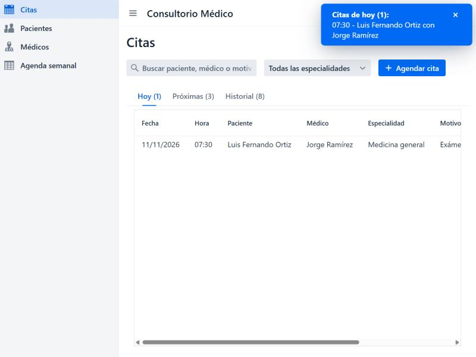
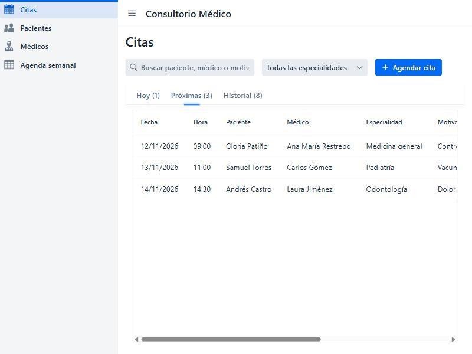
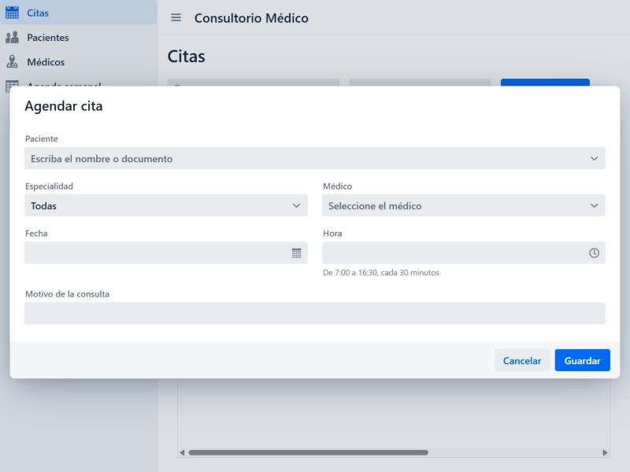
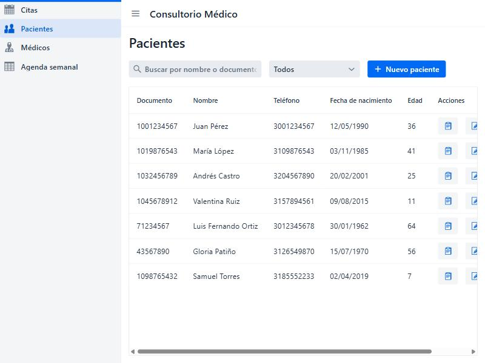
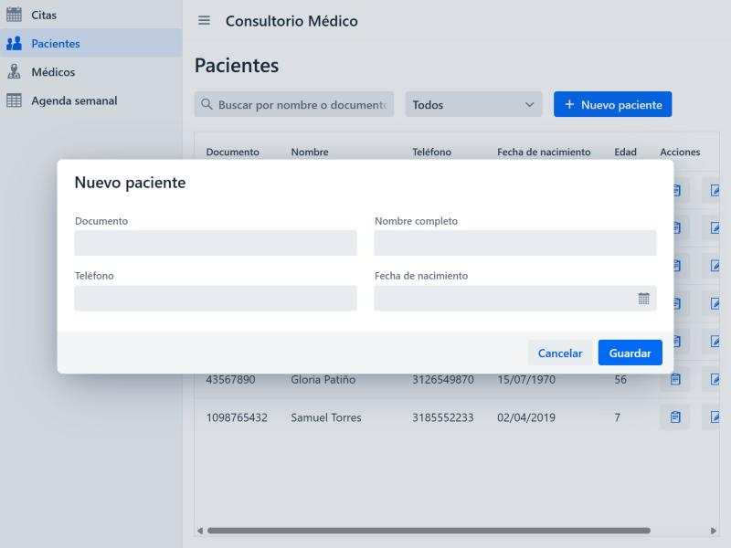
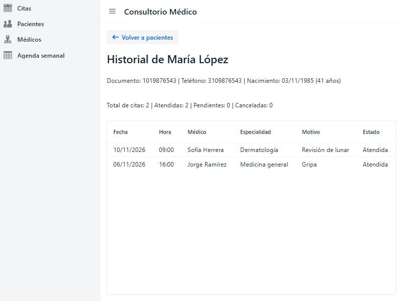
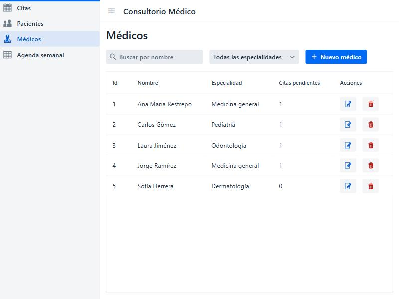
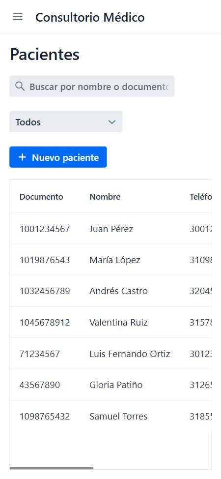
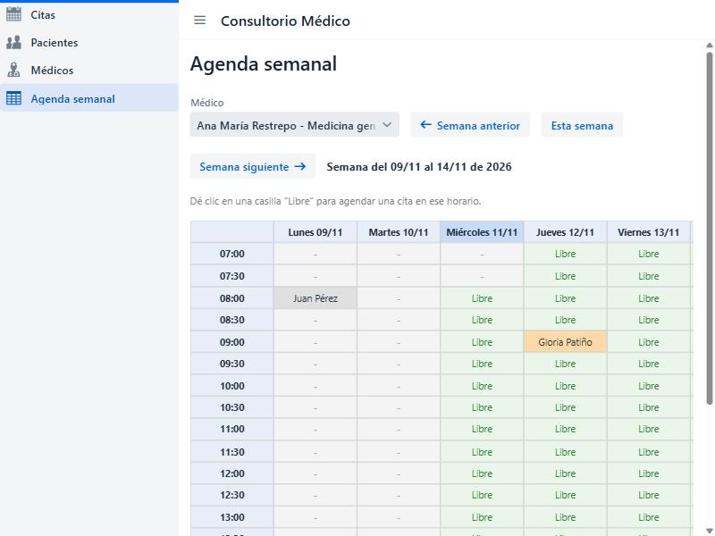

# Citas de consultorio

Proyecto final de **Lógica de Programación** (proyecto 3: Citas de consultorio).

Es una aplicación web hecha con Vaadin para manejar las citas de un consultorio médico. Se pueden registrar pacientes y médicos, agendar citas en franjas de 30 minutos, cancelarlas o reprogramarlas y ver el historial de cada paciente. Toda la información se guarda en archivos `.txt`.

**Autor:** Juan Esteban
**Fecha:** noviembre de 2026

---

## Cómo ejecutarlo

Se necesita tener instalado **Java 21** (o más nuevo). Maven no hace falta instalarlo porque el proyecto trae el wrapper (`mvnw`).

1. Clonar el repositorio:
   ```
   git clone https://github.com/juanes130jeoo-creator/citas-consultorio.git
   cd citas-consultorio
   ```
2. Ejecutar la aplicación:
   - En Windows: `mvnw.cmd spring-boot:run`
   - En Linux / Mac / Git Bash: `./mvnw spring-boot:run`
3. Abrir en el navegador: **http://localhost:8080** (normalmente se abre solo).

La primera vez se demora un rato porque descarga las dependencias y arma el frontend.

### Datos

Los datos se guardan en la carpeta `datos/` en tres archivos, con los campos separados por `|`:

| Archivo | Formato de cada línea |
|---|---|
| `pacientes.txt` | `documento\|nombre\|telefono\|fechaNacimiento` |
| `medicos.txt` | `id\|nombre\|especialidad` |
| `citas.txt` | `id\|documentoPaciente\|idMedico\|fecha\|hora\|motivo\|estado` |

Si la carpeta no existe, la aplicación la crea sola con datos de ejemplo (5 médicos, 7 pacientes y 10 citas cerca de la fecha de hoy) para poder probar todo de una vez. Para volver a empezar con los datos de ejemplo solo hay que borrar la carpeta `datos/` y ejecutar otra vez.

Si una línea de un archivo está dañada, la app la salta y sigue funcionando (todo está con try/catch).

---

## Manual de uso

La aplicación tiene un menú a la izquierda con las vistas: **Citas**, **Pacientes**, **Médicos** y **Agenda semanal**. En el celular el menú se esconde y se abre con el botón ☰.

### Citas (pantalla principal)

Al abrir la aplicación sale una notificación arriba a la derecha con las citas que hay para hoy.



Las citas están separadas en tres pestañas:
- **Hoy**: las citas del día.
- **Próximas**: las citas programadas de mañana en adelante.
- **Historial**: las citas que ya pasaron y las canceladas.

Arriba hay un buscador (busca por paciente, documento, médico o motivo mientras uno escribe) y un filtro por especialidad.



En las citas que siguen programadas aparecen los botones **Reprogramar** y **Cancelar**. Cancelar pide confirmación antes.

### Agendar una cita

Con el botón **Agendar cita** se abre el formulario. Se elige el paciente, la especialidad (filtra los médicos), el médico, la fecha, la hora y el motivo.



Reglas que revisa el programa antes de guardar:
- Las citas son cada 30 minutos, desde las 7:00 hasta las 16:30 (la última termina a las 17:00).
- No se pueden agendar citas en el pasado (ni en una hora de hoy que ya pasó).
- Los domingos no se atiende.
- Un médico no puede tener dos citas a la misma hora.
- Un paciente tampoco puede tener dos citas a la misma hora.
- Al reprogramar se revisan las mismas reglas. Las citas canceladas no ocupan el horario.

Si algo está mal sale una notificación roja diciendo qué pasó.

### Pacientes

Lista de pacientes con buscador por nombre o documento y un filtro por edad (niños, adultos, adultos mayores).



Con **Nuevo paciente** se abre el formulario. Se valida que el documento tenga solo números (6 a 10), que el nombre tenga solo letras, que el teléfono tenga de 7 a 10 números y que la fecha de nacimiento no sea en el futuro. No se pueden repetir documentos.



En cada fila hay tres botones: ver historial, editar y eliminar. Para eliminar se pide confirmación, y no deja eliminar a un paciente que tenga citas pendientes.

### Historial del paciente

Muestra los datos del paciente, cuántas citas tiene (atendidas, pendientes y canceladas) y la lista de todas sus citas. Se abre con el botón del portapapeles en la lista de pacientes.



### Médicos

Lista de médicos con buscador por nombre y un filtro por especialidad. También muestra cuántas citas pendientes tiene cada uno. Se pueden agregar, editar y eliminar (igual, no deja eliminar si tiene citas pendientes).



### En el celular

La aplicación se puede usar desde el celular: el menú se esconde, las barras de botones bajan de línea y las tablas se pueden mover de lado.



---

## Bonificación: agenda semanal del médico

En el menú **Agenda semanal** se ve la semana de un médico como una matriz (parecido al tablero del Buscaminas, armado con layouts):

- Las **columnas** son los días de lunes a sábado.
- Las **filas** son las franjas de 30 minutos desde las 7:00 hasta las 16:30.
- Las casillas **ocupadas** muestran el nombre del paciente (en naranja; si ya pasó, en gris). Al pasar el mouse se ve el motivo.
- Las casillas **libres** dicen "Libre" en verde. Al darles clic se abre el formulario de agendar cita con el **médico, la fecha y la hora ya puestos**, solo falta elegir el paciente y el motivo.
- Las horas que ya pasaron salen con un guion y no se pueden usar.
- Con los botones **Semana anterior** y **Semana siguiente** se cambia de semana, y **Esta semana** vuelve a la actual.



### Cómo probar la bonificación

1. Ejecutar la aplicación con los datos de ejemplo (si ya se usó antes, borrar la carpeta `datos/` para empezar limpio).
2. Entrar a **Agenda semanal** en el menú.
3. Elegir un médico en la lista, por ejemplo *Carlos Gómez - Pediatría*. Se ven sus citas de la semana con el nombre del paciente (con los datos de ejemplo tiene una hoy a las 10:30 con Valentina Ruiz).
4. Dar clic en una casilla que diga **Libre**. Se abre el formulario con el médico, el día y la hora ya llenos.
5. Elegir un paciente, escribir un motivo y dar **Guardar**. La casilla ahora muestra el nombre del paciente.
6. Usar **Semana siguiente** / **Semana anterior** para ver otras semanas.
7. Si se intenta agendar desde otra vista en esa misma hora con ese médico, el programa no lo deja porque ya está ocupada.

---

## Tecnologías

- Java 21
- Spring Boot 4.1.2
- Vaadin 25.3.5 (componentes gratuitos: AppLayout, SideNav, Grid, TextField, ComboBox, Select, DatePicker, TimePicker, TabSheet, Dialog, ConfirmDialog, Notification, FormLayout)
- Maven (con el wrapper `mvnw`)
- Archivos `.txt` para guardar los datos

## Estructura del proyecto

```
src/main/java/com/example/citas/
├── CitasApplication.java        -> clase principal
├── modelo/                      -> Paciente, Medico, Cita
├── datos/ArchivoDatos.java      -> leer y guardar los .txt
└── vistas/
    ├── MainLayout.java          -> menú y notificación de citas de hoy
    ├── CitasView.java           -> pestañas Hoy / Próximas / Historial
    ├── CitaFormulario.java      -> agendar y reprogramar con validaciones
    ├── PacientesView.java       -> CRUD de pacientes
    ├── HistorialPacienteView.java
    ├── MedicosView.java         -> CRUD de médicos
    ├── AgendaSemanalView.java   -> bonificación
    └── Mensajes.java            -> notificaciones de éxito y error
```
